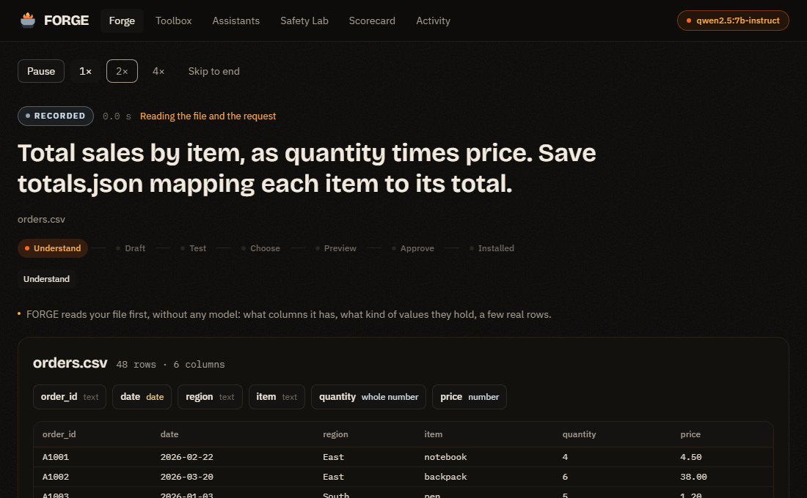
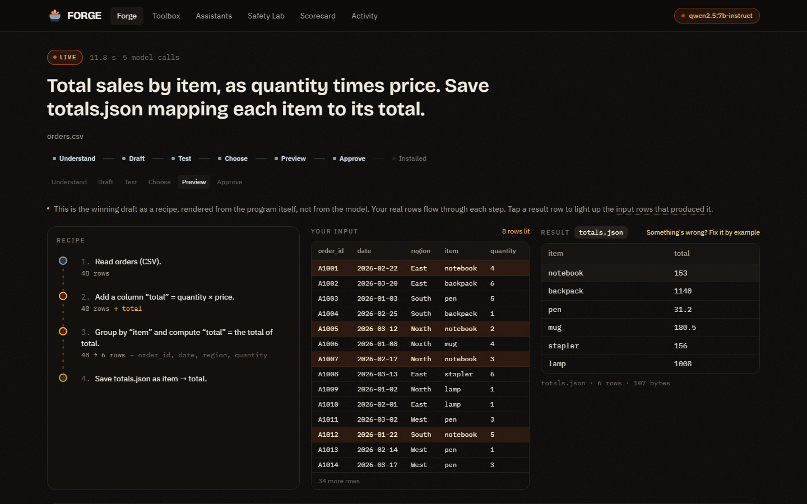
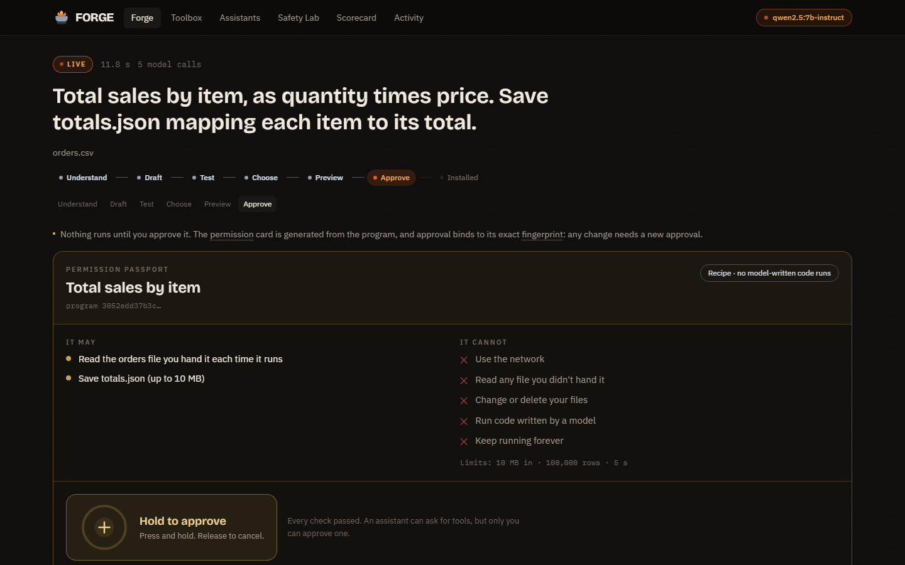

# FORGE

**AI assistants can only use the tools they've been given. FORGE builds the
missing tool while you watch, and nothing runs until you approve it.**



You describe a result in plain language and hand FORGE a file. A free model
on your own computer writes several small programs, called recipes. FORGE runs
every one against your data and against tricky variants of it, keeps the
behavior most drafts agree on, and asks you when two readings genuinely differ.
It shows exactly what the winner does to your rows and exactly what it may
touch. When you approve it, it becomes a tool that any MCP assistant (Claude
Code, Claude Desktop, Cursor) can call. Nothing is paid, and nothing leaves the
machine.

## Quickstart

```bash
git clone https://github.com/youssef061204/FORGE && cd FORGE
npm install
npm run forge        # checks your setup, starts http://127.0.0.1:3110, opens the browser
```

No model? It still starts: the tour, recorded builds, the Safety Lab and
in-browser tool runs all work. To forge live, install
[Ollama](https://ollama.com), download a model yourself
(`ollama pull qwen2.5:7b-instruct`), and start it on this computer only:

```powershell
$env:OLLAMA_HOST = "127.0.0.1:11435"; $env:OLLAMA_NO_CLOUD = "1"; ollama serve
```

`npm run doctor` diagnoses anything that's missing. Docker:
`docker compose up --build -d`.

Connect an assistant: `claude mcp add --transport http forge http://127.0.0.1:3110/api/mcp`
(other clients on the Assistants page).

## How it works

| | |
| --- | --- |
|  |  |
| The winning recipe, rendered in English from the program itself, with your real rows flowing through each step. Tap a result to light up the rows that produced it. | The passport says what the tool may do and what it can't. Press and hold to approve. Approval binds to the program's exact hash. |

1. **Understand.** FORGE profiles the file without a model, then one short
   model call restates the request and lists the capabilities it needs. A
   request to send email, post to Slack or fetch a URL ends as *"FORGE can't
   do this yet"*. It is never quietly turned into a saved file.
2. **Draft.** Five drafts stream in, in a recipe language a 7B model writes
   well: a flat list of `filter`, `derive`, `summarize`, `join`, `match`… with
   short expressions like `num(quantity) * num(price)`.
3. **Test.** Each draft runs on your data, on host-made variants (empty,
   one row, doubled, shuffled, blank cells, punctuation, negative numbers) and
   on seeded random samples, and against properties chosen from its shape.
4. **Choose.** Drafts with identical behavior are grouped. A clear majority
   wins ("3 of 4 drafts agree"). A close split becomes the smallest example
   where they differ and the question *"which did you mean?"*.
5. **Preview, approve, install.** You see the result, fix it by example if
   it's wrong, and approve. The tool appears in every connected assistant's
   tool list at once, and disappears when you revoke it.

More: [architecture](docs/ARCHITECTURE.md) · [the recipe language](docs/RECIPES.md)
· [security](docs/SECURITY.md) · [evaluation](docs/EVALUATION.md) ·
[decisions](docs/DECISIONS.md).

## Scorecard

<!-- numbers:start (generated by scripts/readme-numbers.ts; do not edit by hand) -->
| Set | Result | 95% interval | Median time to preview | Source |
| --- | --- | --- | --- | --- |
| Validation (71, held out) | **56 of 71 (78.9%)** | 68%–86.8% | 7.4 s | `evaluation/results/2026-11-17-27b8ed7/validation.json` |
| Development (18) | 17 of 18 (94.4%) | 74.2%–99% | 6.0 s | `evaluation/results/2026-11-17-eb13a9c/dev.json` |
| Development, before FORGE 2 | 1 of 18 | — | 57.7 s per mission | `evaluation/results/2026-11-17-c8b172f-legacy-baseline/result.json` |

Validation detail: 8 of 10 connect/clarify/unsupported decisions correct; 5 verified-but-wrong results; p95 time to preview 18.1 s. Model qwen2.5:7b-instruct on NVIDIA GeForce RTX 5050 Laptop GPU (8 GB), commit 27b8ed7.
<!-- numbers:end -->

Every number above is read from a committed result file and comes with the
command that reproduces it (`npx tsx evaluation/runner.ts --corpus=validation`).
The validation set was frozen by hash before its first run and never used for
prompts, examples or tuning. The development set was iterated on, so read it as
a ceiling. Failures are kept, with their tapes, and replay on the Scorecard
page.

## Security in brief

- Recipes can't name a file, a socket or a process, so a tool **cannot loop
  forever, reach the network or read anything you didn't hand it**. No
  model-written code runs.
- Only a person approves, in FORGE's UI; no MCP call can. Approval binds to
  the exact program; versions never inherit permissions.
- A broker checks every run: active tool, unaltered program, each input
  against a read grant, each output against a write grant by name and size.
  Repeated events never write twice. Every refusal leaves a receipt.
- One loopback-only door out on the server, `connect-src 'self'` in the
  browser, no telemetry, no automatic model downloads.
- The Safety Lab fires eleven real attacks at a scratch FORGE; all are
  stopped, and each is an automated test.

## Earlier research

The previous generation (a household simulator, a city simulator, Google
connectors, AWS adapters and a TypeScript-generating pipeline) is preserved at
the [`legacy-v0`](https://github.com/youssef061204/FORGE/tree/legacy-v0) tag.
Its best measured result on the 18-mission development set was 7 of 18
(older TypeScript path, October 2026). Its newer IR path, rerun unmodified
before this overhaul, solved 1 of 18 with the same model and GPU.

## License

See [LICENSE](LICENSE).
