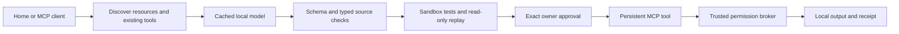

# FORGE

**When your assistant needs a tool it doesn't have, FORGE builds it.**

Describe a task and attach a small CSV, JSON or text file. FORGE discovers available operations, writes executable TypeScript with a local model, compiles and tests it, and runs a read-only replay. You approve exact file access before installation. The tool creates a real downloadable output and remains available through MCP.

The main journey is **Home → review → approve → result**. **Tools** holds installed software; **Activity** records its work. **Inspect** contains source, versions, permissions and research evidence. The Digital Twin is a secondary proving ground.

**Open the verified local instance: <http://127.0.0.1:3108/>.** The packaged compiler/MCP/download flow and real process-restart persistence pass, as do 232 unit tests, 20 legacy browser scenarios, the real local-model browser lifecycle, Windows/Linux builds and desktop/mobile inspection. The final natural-language benchmark completed **7/18 missions**: 7/14 file tasks, 0/2 missing-service decisions and two blocked dependencies. This is a working bounded prototype with substantial reliability limits. [Release evidence](artifacts/next-release-verification.json), [full 24-topic report](docs/NEXT_REPORT.md).

## Free-only operation

The current work forbids paid features. `FORGE_FREE_ONLY=true` is the default even when unset. Paid AWS adapters and external connectors with unverified pricing fail before credentials or network activity. Earlier Bedrock proofs remain historical evidence. No cloud model fallback, automatic model pull, AWS deployment or paid speech service is used. [Enforcement and tests](docs/FREE_ONLY.md).

The interactive compiler uses Ollama with **already installed local GGUF weights**. This machine has `qwen2.5:7b-instruct` cached. Start its local server with cloud features disabled:

```powershell
$env:OLLAMA_HOST = '127.0.0.1:11435'
$env:OLLAMA_NO_CLOUD = '1'
ollama serve
```

Ollama documents this [local-only setting](https://docs.ollama.com/faq). FORGE checks installed model metadata and rejects remote URLs, cloud models and redirects. When the model is unavailable, installed tools still work and generation reports its actual status.

With Node 24+, in another terminal:

```powershell
npm ci
$env:FORGE_FREE_ONLY = 'true'
$env:FORGE_RUNTIME_MODE = 'fixture'
$env:FORGE_LOCAL_MODEL = 'qwen2.5:7b-instruct'
$env:FORGE_LOCAL_MODEL_URL = 'http://127.0.0.1:11435'
npm run dev -- --port 3108
```

Open **[FORGE Home](http://127.0.0.1:3108/)**. Stop an existing server on that port first. Fixture remains the default for old reproducible facilities; the normal interactive compiler uses a local model without keyword routing. `FORGE_INTERACTIVE_PROVIDER=offline` explicitly disables generation.

## Create something useful

Upload your own file, then describe the transformation and output you need. For example, given item, quantity and price columns, ask for a JSON file calculating each item's total. There is no task-specific handler: the generated function reads file data, computes the result and proposes a typed save operation.

1. Add a file and describe a result.
2. Review checks, replay and requested access.
3. Approve the exact tool version, then run it.
4. Download the output. Refresh to find the tool in Tools; edit, pause or revoke it there.

Inputs are immutable and capped at 16 KiB, 20 files, 200 CSV rows and 20 columns. Different contents require a different input filename, keeping an approved tool's file binding unambiguous. Outputs are capped at 5,000 UTF-8 bytes and 100 files. Generated code gets no raw filesystem, network or credentials. The trusted connector parses formats; generated software performs the task logic. Files remain in local state and download through the owner API.

The local model makes mistakes. Admission rejects schema, type, test and replay failures; one bounded local repair is allowed. These checks do not prove that every accepted program fulfills its natural-language goal. The frozen mission benchmark independently checks output semantics and retains failures.

The [actual local-model browser proof](artifacts/local-synthesis/browser-proof.json) verifies this flow through MCP discovery/invocation, the real downloaded file, natural v1.1.0 extension with fresh approval, refresh persistence and revoked execution. It uses cached `qwen2.5:7b-instruct` weights and zero paid requests. The [main production proof](artifacts/local-synthesis/production-proof.json) independently generates and installs a tool; the [actual restart proof](artifacts/local-synthesis/production-restart-proof.json) retains its hash, invokes it and downloads correct output after the main process restarts. Full-corpus failures remain in the [current report](docs/NEXT_REPORT.md).

## Local Docker

Start the host Ollama server as above, then preserve the existing state volume:

```powershell
docker compose -f compose.yaml -f compose.local.yaml up --build -d --wait
```

Docker Desktop reaches the local model through `host.docker.internal:11435`; that bridge was checked locally. The app stays on `127.0.0.1:3108`. Retain existing configuration overlays when updating an established instance: `-f compose.google.yaml` preserves Google settings, and `-f compose.gpu.yaml` preserves configured local GPU execution. Do not remove the `forge-data` volume.

## Architecture



The broker checks current authority, source hash, connector binding and schemas. It persists execution plans and receipts, suppresses duplicate events, and blocks uncertain writes. Schedules and owner-delivered connector events run locally; no remote webhook subscription or cloud scheduler is claimed. A bounded event ledger stops new admission at capacity instead of discarding deduplication history.

`/api/mcp` uses the official TypeScript SDK and Streamable HTTP. Pending tools are absent from `tools/list`; approved tools appear and execute through `tools/call`; revocation removes authority. The web interface builds through the same endpoint. Native Alexa+ deployment is unverified. FORGE is a self-hosted capability foundry designed for assistants such as Alexa+.

## Verification

```powershell
npm run typecheck
npm run lint
npm test
npm run test:product:e2e
npx playwright test --config playwright.local.config.ts
npm run test:e2e
npm run evaluate
npm run evaluate:trust
npm run build
```

The local-model browser flow and synthesis benchmark require cached weights and the local server. Other suites use explicit injected or deterministic providers; these never replace failed real inference.

```powershell
npx tsx scripts/verify-local-model.ts
npx tsx scripts/benchmark-local-missions.ts --model=qwen2.5:7b-instruct
npm run benchmark:product
npx tsx scripts/benchmark-product-reliability.ts
```

The frozen natural-language corpus has independent expected file contents and retains every failure, source attempt, authority set and duration. Once its failures inform development, it is a transparent development benchmark rather than a blind held-out test. The separate 100-case product benchmark uses hand-authored recorded source to measure execution/replay. Do not combine those denominators. [Current overhaul report](docs/NEXT_REPORT.md), [175-second demo](docs/NEXT_DEMO.md).

The October 10 research run completed all 31 stages; its CUDA-unavailable result remains unchanged. A separate [October 23 host CUDA component run](artifacts/ml/gpu-futures-2026-10-23.json) measured maximum reference error 4.55×10⁻⁷ and observed 2,446 field futures/second at batch 1,024. Timing varied and the host clock jumped during the run; this is no stable whole-City speedup claim. The optional [application GPU bridge remains unverified](artifacts/next-main-gpu-proof.json) because automatic approval review blocked launching its helper. Forecasts, virtual-camera accuracy and bounded formal results remain scoped to simulator artifacts. [Research benchmark](docs/ML_BENCHMARK.md), [current résumé bullets](docs/NEXT_REPORT.md#21-resume), [design decision](docs/NEXT_OVERHAUL.md), [verification history](docs/VERIFICATION.md).

## Preserved systems and limits

Google OAuth, Gmail/Calendar adapters, OpenAPI parsing, external MCP clients, signing and historical AWS adapters remain. Google reconnection was declined, so this work makes no Google write claim. External execution with unknown pricing is blocked. Spotify is outside the current scope.

The Twin retains traffic, hazards, Futures, forecasting, virtual cameras, optimization and safety evidence. Pan, zoom and select assets; it does not control real infrastructure. Studio, World, capsules and Lab remain compatibility/research facilities behind Inspect.

Voice uses browser recognition support and preserves typed text. The [production Home voice check](artifacts/next-production-ui-voice.json) verifies transcript/stop behavior and recovery from microphone denial using injected browser APIs. Physical microphone, recognition service and speaker behavior remain unverified; no paid transcription service is configured.

Local persistence assumes one server process. Shared bearer authorization is not a multi-tenant identity system. Keep the server on loopback; public deployment needs separate owner identity and TLS. Tests, replay and sampled simulation do not establish universal safety.

[MIT license](LICENSE).
