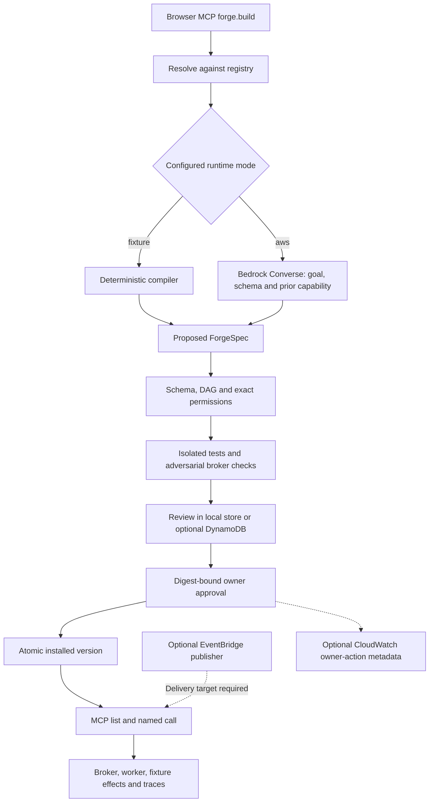

# AWS adapters and deployment path

The City compiler's refreshed real Bedrock proof is recorded in [VERIFICATION](VERIFICATION.md): profile forge, selected Region ca-central-1, configured Sonnet inference profile, strict generated response/source validation, three real programs and 20 Futures per program, followed by approval and successful MCP invocation. Bedrock performs capability interpretation and code synthesis. The City simulator, tests, local Ed25519 signatures, voice recognition and narration do not falsely count as additional live AWS services.

For an isolated Windows recording server, set FORGE_RUNTIME_MODE=aws, MODEL_PROVIDER=bedrock, AWS_PROFILE=forge, AWS_REGION=ca-central-1, BEDROCK_MODEL_ID=us.anthropic.claude-sonnet-4-5-20250929-v1:0 and a separate FORGE_DATA_DIR, then run npm run start -- --port 3116 after a production build. Use the normal SDK credential chain. The main Compose submission remains fixture and does not receive AWS credentials. AWS access/model failures surface; no automatic fixture fallback.

AWS integrations are implemented using AWS SDK v3. **Live Bedrock compilation was verified on 2026-10-06 using profile `forge` and region `ca-central-1`.** The proof called FORGE's actual compiler, validated the generated ForgeSpec, then installed and invoked the new MCP tool in an isolated harness. No application infrastructure has been deployed. SDK contract tests use injected clients and are separate from the live evidence in [VERIFICATION.md](VERIFICATION.md).

| Service         | Implemented use                                                                                                         | Configuration                                        |
| --------------- | ----------------------------------------------------------------------------------------------------------------------- | ---------------------------------------------------- |
| Bedrock         | Converse generates a structured capability; outputs pass the same validator; two-output retry cap                       | FORGE_RUNTIME_MODE=aws, BEDROCK_MODEL_ID, AWS_REGION |
| DynamoDB        | Persist releases, installed contracts, executions, effects and audit; optimistic revision writes                        | STORE_PROVIDER=dynamodb, DYNAMODB_TABLE              |
| EventBridge     | Publish capability event envelopes; reject failed entries                                                               | FORGE_EVENT_BUS                                      |
| CloudWatch Logs | Export completed API action metadata; surface export failure separately from durable action success                     | FORGE_LOG_GROUP                                      |
| KMS             | Optional Capsule signing with regional RSA_2048 SIGN_VERIFY key, RSASSA_PSS_SHA_256 and offline public-key verification | FORGE_KMS_KEY_ID; explicit AWS mode                  |
| S3              | Optional content-addressed signed Capsule upload with conditional creation and server-side AES256 encryption            | FORGE_ARTIFACT_BUCKET; explicit AWS mode             |

**Expansion evidence:** a real Bedrock request generated Deadline Guardian's TypeScript source through FORGE's compiler. The request returned HTTP 200 in 18,608ms, schema and strict source validation passed, all 22 admission checks passed, and the capability completed fixture replay and actual MCP invocation. Request ID: `b99d53ec-ff24-4afb-b15c-dc4ba88d671f`; recorded at `2026-10-07T03:12:16.345Z`. KMS/S3 are implemented and tested with injected SDK clients; neither service has live evidence here. Default Capsule signing is real local Ed25519, accurately labeled.

To rerun the executable proof, set the profile, region, model and AWS mode below, then additionally set `FORGE_VERIFY_DOMAIN=live` before `npm run verify:bedrock`. This makes one paid Converse request per verification run through the actual compiler. It records request/provider metadata, validates ForgeSpec and source, runs checks/replay, installs in isolated state and invokes the new MCP tool. The verifier uses one output attempt and fails clearly; normal compilation has a two-output validation retry bound. Neither path silently substitutes fixture generation. Runtime effects in this verifier are explicitly fixture/shadow, not Google writes.

Use only existing regional keys/buckets in `ca-central-1` if opting into KMS/S3. No such resources were created for this expansion. The normal AWS SDK credential chain resolves the `forge` profile; no static credentials belong in source or configuration examples.

The AWS default credential chain stays in the trusted backend. Do not inject AWS credentials into the worker, browser, ForgeSpec, or repository. Bedrock usage tokens are taken from the response; price is `null` rather than inventing a cost for an unspecified model. The deterministic primitive runtime makes no LLM calls.

## Minimum cloud-backed compilation proof

Bedrock alone is sufficient for the requested cloud reasoning stage; keep local storage and fixture effects for the first live demo. DynamoDB, EventBridge and CloudWatch are optional supporting services, not prerequisites or extra work to claim a bigger architecture.

```powershell
$env:AWS_PROFILE = 'forge'
$env:AWS_REGION = 'ca-central-1'
$env:BEDROCK_MODEL_ID = 'us.anthropic.claude-sonnet-4-5-20250929-v1:0'
$env:FORGE_RUNTIME_MODE = 'aws'
npm run verify:bedrock
```

This command resolves backend credentials without logging them, calls real Bedrock Converse through `forge.build`, validates the resulting capability, approves it in an isolated test harness, then discovers/invokes it with the MCP SDK. It writes `artifacts/bedrock-proof.json` with provider, profile, region, inference profile, request duration, AWS response request ID, schema validation status, input/output token counts, release digest and actual execution. Configuration, authorization, schema or execution failures produce `passed=false` and a nonzero exit code. There is no fallback to the deterministic planner. SDK request retries are disabled. The verifier permits exactly one cloud request; invalid output fails the proof. The production compiler can correct invalid output once, with token usage accumulated across both attempts.

The latest Internship Scout live run, after adding World, returned HTTP 200 in 13,114 ms, with 2,484 input and 1,082 output tokens. ForgeSpec validation and all 22 executable checks passed. The new `internship_scout` tool was discovered and executed successfully with six sandbox steps. The AWS request ID is `012de1f3-be8d-48e7-92ac-1cbfc93a1ab6`. Injected SDK tests separately verify trusted contract derivation, malformed-output retries, permission-escalation and cyclic-DAG rejection, and unchanged propagation of cloud errors.

World compilation also passed a genuine live request: set `$env:FORGE_VERIFY_DOMAIN = 'world'` before the same command to compile `leaving_home`, validate 23 checks, install/discover it and execute eight world-changing steps. It writes the separate `artifacts/bedrock-world-proof.json`. The successful request took 16,758 ms with 2,479 input / 1,440 output tokens; request ID `83e8aaaf-967e-4c63-b488-954855f28998`. [World semantics and reproducible command](WORLD.md). Clear `FORGE_VERIFY_DOMAIN` to use the default Internship Scout proof again. Neither proof changes fixture mode as the default.

The configuration names above were provided by the owner and used successfully in the live proof. The [official Sonnet 4.5 model card](https://docs.aws.amazon.com/bedrock/latest/userguide/model-card-anthropic-claude-sonnet-4-5.html) lists `ca-central-1` as a source for this US inference profile, with destinations in Canada and US regions. Calls may cross the Canadian border. Scope IAM/project policies to the inference profile and allowed destination model ARNs.

After a passing proof, start the app with `FORGE_RUNTIME_MODE=aws` and the same profile, region and model. Remove conflicting legacy `MODEL_PROVIDER=demo`; contradictory modes fail validation. `npm run verify:http` on a fresh loopback server records actual compilation provider/usage. Match its bearer token when configured. Source matching and letters remain deterministic primitives; only compilation calls Bedrock. `FORGE_RUNTIME_MODE=fixture` is the default.

## Runtime path and service responsibilities



| Service         | Why / input → output                                                                                  | Failure/fallback                                                                                               | Security and cost                                                                                                                                  |
| --------------- | ----------------------------------------------------------------------------------------------------- | -------------------------------------------------------------------------------------------------------------- | -------------------------------------------------------------------------------------------------------------------------------------------------- |
| Bedrock         | Capability proposals: goal, schema, contracts, previous definition → DAG and actual token/request IDs | Cloud failure surfaces; no automatic fixture fallback. Two output attempts maximum.                            | Backend credentials; output grants no authority. Cross-region routing; model token charges vary, estimate remains null.                            |
| DynamoDB        | Durable metadata: validated state/revision → conditional committed revision                           | Failed commit blocks installation; no local substitution after selecting DynamoDB. Default store is local.     | Configured-table IAM; 350KB snapshot ceiling; read/write/storage charges.                                                                          |
| EventBridge     | Event decoupling: capability ID/event → accepted event ID                                             | Failed publishing surfaces; unconfigured LocalEventBus dispatches locally. Publication alone does not execute. | Payload may contain source data; restrict bus/target IAM. Event/delivery charges; scheduler not implemented.                                       |
| CloudWatch Logs | Owner action export: action, record ID, timestamp → log event                                         | Durable action remains; export failure warns and retains local audit.                                          | No raw goals/resumes/model output/secrets exported. Ingestion/retention charges. MCP stdout telemetry is separate from this owner-action exporter. |

Application stdout uses structured allowlisted metadata: transport, known method/action, status, timestamp and duration. Raw payloads and arbitrary exception messages are excluded. Stored build stages and primitive/event traces are execution observations, not model reasoning. Approval decision timing stops before commit; completed owner API duration includes persistence. Health metadata reports configuration, not cloud connectivity.

## Foundation resources

`infra/foundation.yaml` provisions a DynamoDB table, EventBridge bus, log group/stream and least-scope ECS task role for these adapters. It deliberately does not provision a Fargate service, load balancer, API Gateway, public DNS or distributed sandbox. Deploying resources incurs account-specific costs and requires your AWS account configuration; deployment is a separate operational step.

```sh
aws cloudformation validate-template --template-body file://infra/foundation.yaml
aws cloudformation deploy --template-file infra/foundation.yaml --stack-name forge-foundation --capabilities CAPABILITY_NAMED_IAM --parameter-overrides BedrockModelArn=<authorized-model-or-inference-profile-arn>
```

These commands are provided for account-owner execution; they have not been run here. Inference profiles may require additional permitted model ARNs; scope those according to the selected model's documented access requirements.

Build the optional application image with `docker build -f infra/Dockerfile -t forge-app .`. It runs the Next standalone Node server and the permission-restricted process worker. It does not expose a host Docker socket. In a cloud container use the process DSL path; a dedicated external sandbox service would be required for arbitrary generated native code.

## Event delivery

`POST /api/forge` with action=publish uses EventBridge when configured, otherwise LocalEventBus executes locally. Publishing to EventBridge alone does **not** execute a capability. An account-owner-configured EventBridge target must forward the event to the authenticated ingress:

```json
{
  "action": "event",
  "id": "internship-scout",
  "event": {
    "id": "unique-event-id",
    "type": "new_job_posting",
    "payload": {
      "posting": {
        "id": "job-1",
        "title": "AI Intern",
        "company": "Example",
        "requirements": ["Python"],
        "description": "Fixture"
      }
    }
  }
}
```

Use a TLS endpoint and an API destination connection with the configured Authorization bearer credential. Transform detail.capabilityId → id and detail.event → event. The ingress uses the same event schema, approved registry and permission broker. A delivery rule/scheduler is not included or claimed as working. Local scheduled capabilities can be triggered by manual scheduled events.

## Prototype sizing and distributed limits

DynamoDB stores a single-tenant validated snapshot with conditional revision writes. It refuses payloads larger than 350KB before the item limit. Partitioning traces, effects and release records is required for longer-running deployments. Local files are only safe within one server process. Cross-instance execution leases and tenant identity are not implemented. Event delivery and effects have idempotency keys, but only the single-process runtime guarantees shared duplicate execution suppression.

## Official references

[Bedrock Converse SDK examples](https://docs.aws.amazon.com/sdk-for-javascript/v3/developer-guide/javascript_bedrock-runtime_code_examples.html) · [DynamoDB condition expressions](https://docs.aws.amazon.com/amazondynamodb/latest/developerguide/Expressions.ConditionExpressions.html) · [EventBridge API destinations](https://docs.aws.amazon.com/eventbridge/latest/userguide/eb-api-destinations.html)
