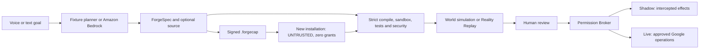

# Progressive Trust and Reality Replay

City software uses the same trust store and revocation path. Its admission evidence is [20 local stochastic Futures](CITY.md); imported City capsules must rerun them locally before owner approval. The [Lab](LAB.md) adds an optional one-use spoken challenge and integrity-signed evidence receipts. Neither voice nor signatures inherit grants.

AI-generated software should not inherit trust from the model that created it. FORGE separates generation from admission.

Generation is probabilistic in AWS mode. Admission uses deterministic checks, policy and owner decisions. Deployment uses least privilege. Operation is observable, revocable and versioned. Sharing transports the artifact, never the user's authority.

## One engine

ForgeSpec now optionally carries a `deadline/v1` TypeScript artifact. The same compiler, validation reports, release digest, registry, version history, owner approval, isolated workflow driver and PermissionBroker operate World, career, household and Google capabilities. Existing releases migrate to explicit trust records without changing their artifacts or granting connector permissions.

## Persisted trust

Trust is keyed by the entire validated release digest, not UI selection. Each record stores a current state, timestamped earned stages, connector/binding identity, replay reference, exact grants and import origin. Model output has no fields for trust, approval or grants.

| Transition                                   | Deterministic gate                                                                                                       | External authority                               |
| -------------------------------------------- | ------------------------------------------------------------------------------------------------------------------------ | ------------------------------------------------ |
| GENERATED → SECURITY_VERIFIED                | Source compile/typecheck, actual sandbox behavior and security report all pass                                           | Zero                                             |
| Earned SANDBOXED / TESTED / SIMULATED stages | Actual checks; World behavior is simulated                                                                               | Zero connector authority                         |
| SECURITY_VERIFIED or UNTRUSTED → REPLAYED    | Same executable replays authorized snapshot; every write intercepted; report passes                                      | Zero writes                                      |
| REPLAYED → HUMAN_APPROVED                    | Owner approves exact release/version/digest; installed tool becomes discoverable                                         | Still zero connector grants                      |
| HUMAN_APPROVED → SHADOW                      | Passing replay on current connector binding; exact read grants approved                                                  | Reads; proposed effects only                     |
| Approved deployment → LIVE                   | Passing replay on current binding; owner grants exact manifest permissions; Google write consent present when applicable | Scoped Calendar writes and local notifications   |
| LIVE/SHADOW → REVOKED                        | Owner revokes, reconnects Google, deletes evidence or rolls back executable version                                      | Grants cleared; revocation disables polling      |
| Any deployment → global paused               | Persisted owner kill switch                                                                                              | Connected dispatch and live broker writes denied |

Security checks can precede replay; stages are evidence milestones, not an animation-driven linear state machine. World stays simulation-only after installation. Imported software has UNTRUSTED current state even after compatible deterministic tests; local replay and approval are still required.

Admission reports contain functional and held-out check results, sandbox implementation, security checks, permissions, replay evidence, budgets, attempted prohibited-action check names, provider, source/release hashes and version. Recommendations are computed by the server: REJECT, REPLAY ONLY, HUMAN APPROVAL REQUIRED, SHADOW or ELIGIBLE FOR LIVE. Eligibility is not permission: promotion always rechecks gates.

## The executable boundary

Source consists of one synchronous `execute(input: ModuleInput): ModuleOutput` function. The host supplies types. No imports, host credentials or connector handles are passed. Strict TypeScript compilation and AST checks run without executing source in the application process. Source is transpiled and evaluated only inside a separate worker process, with a fresh VM context populated exclusively by JSON values, string/Wasm code generation disabled, a 400ms execution limit, 32MB V8 heap and 8KB output limit. The process inherits only fixed environment metadata; it has no secret environment.

The VM is not represented as a certified security boundary. Node permission restrictions and subprocess isolation provide additional boundaries. With the Docker sandbox selection, the module also runs as non-root with no network, a read-only filesystem, dropped capabilities, process/memory/CPU limits and no host mounts. The workflow driver is separately isolated. The default packaged judge server uses process isolation and has no Docker host socket.

The module proposes a strictly validated change; the host independently bounds its sender, title, date and target against the snapshot. Only declared DAG nodes invoke brokered writes. Generated source cannot call Google directly or create arbitrary destinations. Per-write authority checks and dispatch share the local store's serialized transaction with revocation, so a revoke response means earlier in-flight writes have completed and later writes cannot start.

## Reality Replay observations

Google and fixture connectors implement the same snapshot/write interfaces. Replay uses the same sandbox and source as deployment. REPLAY and SHADOW transform every Calendar/notification write into a hypothetical effect and never call `Connector.write`. Later events see the hypothetical Calendar state produced by earlier events, allowing meaningful duplicate/change handling.

The judge bundle spans October 1–31, 2026: eight synthetic messages and two initial Calendar events. Actual observations are three confirmed deadline changes, two deadline updates, one deadline creation, three study-placeholder creations and one notification proposal: seven effects, zero external writes. Five negative/ignored cases include newsletter, unapproved attacker, duplicate date, invalid date and ambiguous schedule text. Independent labels yield eight exact matches and precision/recall 1.0 on this small, explicit-format dataset. That does not establish performance on arbitrary natural-language email.

Google histories are unlabeled; only observed counts are reported. Timelines play already recorded events with pause, speed and inspection controls. Playback never creates new effects or fabricated counts. Live and shadow process unseen eligible messages based on durable live commit markers. Poll configuration, next run, last run/error, trust, versions and pause survive restart. A server startup poller checks schedules every 15 seconds; the UI enables five-minute intervals. It runs only while the single application process is alive.

Version rollback restores previously approved software and clears executable connector grants across versions. It does not undo external Calendar writes. Multi-step external execution is not a distributed transaction; a later failure can leave earlier changes committed, and uncertain provider delivery needs manual reconciliation. Canonical create IDs, ETags, effect receipts and processed markers limit duplicates but do not constitute a general exactly-once guarantee.
